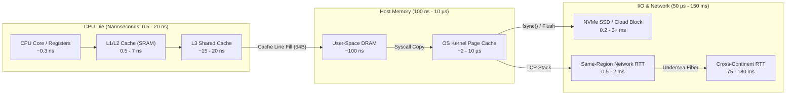

# 1.1: Hardware & Latency Numbers Every Architect Must Know

> **Level**: Level 1 — OS, Hardware & Networking Physics
> **Lab Script**: [`labs/latency_benchmark.py`](labs/latency_benchmark.py)
> **Core Question**: *Why do some systems handle 100,000 RPS on a single box while others melt down at 400 RPS—and how do physical hardware boundaries dictate every architectural pattern we use?*

---

## 0. The "From-Scratch" Computer Science Primer (Zero Jargon)

If words like *CPU Register, L1 Cache, RAM, OS Kernel, Syscall, Page Cache, `fsync`,* or *$p99$ Latency* feel foggy, **start right here**. Everything inside a computer maps to a **Master Carpenter working in a Workshop**:

- **The Carpenter's Brain & Hands = The CPU Core**: The carpenter can hammer or cut wood astonishingly fast, *as long as the wood is already in their hands*.
- **Every Tool & Piece of Wood = Data (Bytes)**: Where the wood is stored determines how long the carpenter stands around waiting instead of working.

### Plain-English CS Vocabulary Table

| Computer Science Term | What It Means in Plain English | The Carpenter's Workshop Analogy |
| :--- | :--- | :--- |
| **CPU Core & Registers** | The tiny calculator brain inside your chip (`Core`) and the microscopic slots (`Registers`) holding the exact numbers it is adding *right now*. | **The Carpenter's Hands**: Holds 1 piece of wood at a time; instant action ($0.3\text{ nanoseconds}$). |
| **CPU Cache (`L1 / L2 / L3`)** | Tiny, ultra-fast memory built *directly inside the CPU chip* to hold data the CPU used a moment ago. | **The Toolbelt (`L1`) & Pocket (`L2`)**: Reaching to your belt takes half a second. Holds very little, but is lightning fast. |
| **RAM (`Main Memory / DRAM`)** | The 16 GB or 32 GB memory sticks on your motherboard where running programs (like Python variables and lists) live. **Volatile**: loses everything if power is unplugged! | **The Workbench Across the Room**: Big enough to hold your whole project, but walking over to grab a board takes $200\times$ longer than reaching to your toolbelt. |
| **SSD / NVMe Disk (`Storage`)** | Your permanent hard drive where files and databases live. **Non-Volatile**: keeps data even when the computer is turned off. | **The Warehouse Down the Street**: Holds millions of boards forever, even if the workshop burns down—but driving there takes **30,000x longer** than grabbing from the workbench. |
| **User Space vs. OS Kernel** | Your Python script runs in **User Space** (a safe sandbox). It is *forbidden* from touching the SSD or Network Card directly. It must ask the **OS Kernel** (Windows/Linux boss) to do it. | **The Warehouse Security Guard (`Kernel`)**: The carpenter isn't allowed to drive the forklift. You must fill out a form and hand it to the guard. |
| **System Call (`Syscall`)** | The formal request your Python program makes to the OS Kernel whenever it wants to read/write a file or send a network packet. | **Filling Out the Request Form**: Pausing your carpentry work to hand paperwork through the security window and waiting for the guard to stamp it. |
| **OS Page Cache** | A clever trick by the OS Kernel: when you tell Python to "write to a file", the OS Guard **lies to you**! Instead of driving to the SSD warehouse, the Guard puts your data on a temporary shelf in RAM (`Page Cache`) and says *"Done!"* so you can get back to work immediately. Later, in the background, the Guard drives a whole truckload to the SSD. | **The Guard's Loading-Dock Clipboard (in RAM)**: Fast ($\sim 9\ \mu\text{s}$), and survives if the Carpenter faints (`process crash`), **but vanishes if the whole building loses electricity (`power outage`)!** |
| **`fsync()` (File Sync)** | A strict command where your program tells the OS Guard: *"Do NOT lie to me and leave this on your RAM clipboard! Drive it to the SSD warehouse right now and don't return until it's locked inside the vault!"* | **Forcing an Immediate Warehouse Trip**: Guarantees zero data loss if power fails, but slows the carpenter down by **300x** ($\sim 3\text{ milliseconds}$ per trip). |
| **Latency vs. Throughput** | **Latency** = How long *one* request takes from start to finish (e.g., $2\text{ ms}$). **Throughput (`RPS / ops/s`)** = How many total requests the system finishes per second. | **Delivery Truck**: Driving from NY to Boston takes $4\text{ hours}$ (**Latency**). Whether you send 1 van or a convoy of 50 trucks side-by-side changes how many boxes arrive per hour (**Throughput**), *not* the 4-hour drive time! |
| **Average vs. $p95 / p99$ Latency** | Sort 100 customer wait times from fastest to slowest. - **$p50$ (Median)**: Customer #50's wait. - **$p95$**: Customer #95's wait. - **$p99$ (Tail Latency)**: The 99th slowest customer out of 100. | **Coffee Shop Line**: If 99 customers get coffee in $1\text{ second}$, and 1 customer waits $100\text{ seconds}$, the **Average** is $\sim 2\text{ seconds}$ (looks great!), while **$p99$ is $100\text{ seconds}$** (1% of your users are furious!). |

---

## 1. First-Principles Mental Model (The "Why")

### The Physical Constraint: Distance & State Persistence
A modern 3 GHz CPU core executes **3 billion clock cycles per second** ($\sim 0.33\text{ ns}$ per cycle). However, the CPU cannot compute on data that isn't inside its registers. Every time your code fetches data or persists state, it crosses a **physical boundary**:
1. **Silicon Distance (SRAM vs. DRAM)**: L1 cache is etched directly onto the CPU core ($0.5\text{ ns}$). Main memory (DRAM) sits centimetres away across the memory bus ($100\text{ ns}$ — **200x slower**). While waiting for a single DRAM fetch, a CPU core sits idle for ~300 clock cycles!
2. **Kernel Boundary (Syscalls)**: Moving bytes from your Python process (User Space) into the OS Kernel (via `write()` or `socket.send()`) requires a privilege switch and memory copy ($\sim 1\text{–}10\ \mu\text{s}$).
3. **Non-Volatile Physics (`fsync` to SSD/EBS)**: Forcing data out of volatile RAM into physical flash cells (or across an AWS EBS storage network) jumps from microseconds to **milliseconds** ($\sim 1\text{–}3\text{ ms}$ — **30,000x slower** than RAM).
4. **Speed of Light in Fiber ($200,000\text{ km/s}$)**: Light travels $200\text{ km}$ per millisecond in fiber-optic glass. A round trip from US-East (Virginia) to EU-West (Dublin) and back ($\sim 11,000\text{ km}$ with routing hops) physically cannot beat $\sim 65\text{–}75\text{ ms}$.

### The Human-Scale Mental Model ($1\text{ ns} = 1\text{ second}$)
Memorize the **orders of magnitude**, not exact decimals. If 1 CPU nanosecond felt like 1 human second:

| Boundary / Operation | Real Latency | Human-Scale Equivalent ($1\text{ ns} = 1\text{ s}$) | Architectural Consequence |
| :--- | ---: | :--- | :--- |
| **L1 Cache Hit** | $0.5\text{ ns}$ | **$0.5\text{ seconds}$** (Grab a pen on your desk) | Contiguous arrays (`numpy`, columnar DuckDB) fly here |
| **L2 / L3 Cache Hit** | $5\text{–}20\text{ ns}$ | **$5\text{–}20\text{ seconds}$** (Walk to the bookshelf) | Keep hot working sets compact |
| **Main Memory (DRAM)** | $100\text{ ns}$ | **$1.5\text{ minutes}$** (Walk down the hall) | Pointer-chasing (linked lists, uncached B-Tree nodes) stalls the CPU |
| **OS Page Cache / Localhost Syscall** | $10\text{–}50\ \mu\text{s}$ | **$3\text{–}14\text{ hours}$** | Crossing User $\leftrightarrow$ Kernel space per item kills throughput; batch syscalls! |
| **NVMe SSD Random Read (4 KB)** | $16\text{–}100\ \mu\text{s}$ | **$4\text{ hours – }1\text{ day}$** | Why we put Redis/Memcached in front of disk databases |
| **Same-Region Cross-AZ Network RTT** | $0.5\text{–}1\text{ ms}$ | **$6\text{–}11.5\text{ days}$** | **Never put 20 sequential microservice calls in a single user request!** ($20 \times 1\text{ ms} = 20\text{ ms}$ floor) |
| **Durable Disk Commit (`fsync`)** | $1\text{–}3\text{ ms}$ | **$11\text{–}35\text{ days}$** | Calling `fsync` per write caps serial throughput at $\sim 300\text{–}1,000\text{ writes/s}$ |
| **Cross-Continent RTT (US $\leftrightarrow$ EU)** | $75\text{ ms}$ | **$2.4\text{ years}$** | Why global systems need CDNs, Edge caches, or Multi-Region replicas |

### Comparison / Trade-Off Matrix: Where Should State Live?

| Dimension | In-Process Memory / Cache (RAM) | OS Page Cache (Buffered File Write) | Durable Disk Commit (`write + fsync`) | Remote Network Call (RPC / DB) | Staff+ Verdict |
| :--- | :--- | :--- | :--- | :--- | :--- |
| **Typical Latency** | $\sim 100\text{ ns}$ | $\sim 2\text{–}10\ \mu\text{s}$ | $\sim 0.5\text{–}3\text{ ms}$ | $\sim 0.5\text{–}5\text{ ms}$ (intra-region) | **30,000x gap** between RAM and durable disk/network |
| **Crash Survivability** | Lost if process crashes OR power fails | Survives **process crash**; lost ONLY if OS kernel panics or host loses power | Survives power loss (flushed to non-volatile media) | Survives single-host power loss if replicated across AZs | Kafka & Redis AOF (`everysec`) exploit **OS Page Cache + Replication** to avoid per-write `fsync`! |
| **Throughput Bottleneck** | CPU instructions / memory bandwidth | Syscall overhead & memory copy rate | Storage IOPS & serial flush latency | Network bandwidth, connection pool & remote queueing | Batching (Group Commit / Pipelining) amortizes fixed boundary costs |

---

## 2. Under the Hood (OS / Network / Storage Internals)

### 1. The 64-Byte CPU Cache Line (Why Contiguous Data Wins)
The CPU never reads a single 8-byte integer from DRAM. Whenever a cache miss occurs, the memory controller fetches a **64-byte Cache Line** into L1/L2 cache:
- **Spatial Locality (Sequential Array / Columnar Store)**: Reading `arr[0]` pulls `arr[0..7]` into L1 cache in one $100\text{ ns}$ trip. The next 7 reads take $0.5\text{ ns}$ each, plus the CPU's **Hardware Prefetcher** detects the sequential stride and pre-loads the next cache lines before your code even asks for them.
- **Cache Thrashing (Pointer Chasing)**: Traversing a scattered object graph in Python or a fragmented B-Tree jumps to random memory addresses, missing L1/L2/L3 cache every single hop.

### 2. The Anatomy of a Write: User Buffer $\rightarrow$ OS Page Cache $\rightarrow$ `fsync()`
Understanding the 3 stages of a file write is mandatory for Level 2 (Databases & Kafka):
1. **`file.write()` (Buffered in User Space)**: Python buffers bytes in process RAM. If your Python process `segfaults` or gets `kill -9`, those bytes vanish.
2. **`file.flush()` / Unbuffered `os.write()` (OS Kernel Page Cache)**: Copies bytes across the User/Kernel boundary into the OS **Page Cache** (kernel RAM) and marks the 4 KB memory page as *Dirty*. The call returns in **microseconds ($\sim 9.5\ \mu\text{s}$)**! The OS asynchronously flushes dirty pages to the SSD in the background every few seconds.
3. **`os.fsync(fd)` (Hardware Durability Barrier)**: Blocks your thread until the OS flushes the dirty pages over the PCIe/NVMe bus (or AWS EBS network) AND the SSD controller confirms the data is written to non-volatile flash (or battery-backed NVRAM). This takes **milliseconds ($\sim 2\text{–}3\text{ ms}$)**.

### 3. The Three Equations of Back-of-the-Envelope Capacity Planning

1. **The Serial Latency Ceiling**:
   $$\text{Max Serial Throughput (per worker)} = \frac{1}{\text{Latency}_{\text{serial}}}$$
   - If a synchronous operation blocks on a $2.5\text{ ms}$ (`0.0025s`) `fsync` or lock, **one sequential worker/lock can never exceed $\frac{1}{0.0025} = 400\text{ ops/sec}$**, even if you have a 64-core CPU sitting at 2% utilization!
2. **Little's Law (Concurrency vs. Throughput)**:
   $$L = \lambda \times W \quad \Longleftrightarrow \quad \text{Concurrent Connections} = \text{RPS} \times \text{Average Latency}$$
   - At $\lambda = 10,000\text{ RPS}$ with $W = 20\text{ ms}$ (`0.02s`) latency, your server holds $10,000 \times 0.02 = 200$ in-flight requests.
   - If downstream database contention spikes $W$ to $250\text{ ms}$ (`0.25s`), in-flight requests instantly balloon to $10,000 \times 0.25 = \mathbf{2,500}$ concurrent requests—exhausting thread pools and connection pools!
3. **Kingman's Queueing Approximation (Why Tail Latency Explodes Before 100% Load)**:
   $$\text{Wait Time in Queue} \propto \left(\frac{\rho}{1 - \rho}\right) \times \text{Service Time}$$
   - Where $\rho$ is resource utilization ($0.0 \rightarrow 1.0$). Notice the $\frac{\rho}{1-\rho}$ curve:
     - At $\rho = 50\%$ utilization: queue wait is $1\times$ service time.
     - At $\rho = 80\%$ utilization: queue wait jumps to **$4\times$** service time.
     - At $\rho = 95\%$ utilization: queue wait explodes to **$19\times$** service time!
   - *Staff+ Rule*: Any shared resource (disk IOPS, DB lock, thread pool) pushed past **70–80% utilization** will experience a hockey-stick explosion in $p99$ latency even when overall host CPU looks idle.

---

## 3. Empirical Results from Our Python Lab

- **Lab File**: [`labs/latency_benchmark.py`](labs/latency_benchmark.py)
- **Observed Metrics on Our AWS WorkSpace (Windows, Python 3.14 `.venv`)**:

| Operation / Boundary Crossed | Median Latency | P95 Batch Latency | Serial Ceiling (ops/s) | Penalty vs. RAM |
| :--- | ---: | ---: | ---: | ---: |
| **1. RAM Lookup** (`Python list[i]`) | **`85.3 ns`** | `117.7 ns` | `11,720,993 ops/s` | **1.0x (Baseline)** |
| **2. CPU Compute** (`SHA-256` on 4 KiB) | **`3.877 us`** | `4.575 us` | `257,958 ops/s` | **45.4x slower** |
| **3. OS Page Cache Write** (`write` only, no `fsync`) | **`9.523 us`** | `10.500 us` | `105,010 ops/s` | **111.6x slower** |
| **4. TCP Loopback RTT** (`127.0.0.1` 64B echo) | **`54.687 us`** | `56.587 us` | `18,286 ops/s` | **641.0x slower** |
| **5. Durable Disk Write** (`write` + `os.fsync`) | **`2.924 ms`** | `3.333 ms` | **`342 ops/s`** | **34,267x slower** |

### Why the Numbers on Your Machine Look Like This:
1. **The 307x Gap Between Page Cache (`9.52 us`) and `fsync` (`2.924 ms`)**:
   - Look at Row 3 vs. Row 5: writing 128 bytes to the Windows OS Page Cache can sustain **105,010 writes/sec** on a single thread. The moment we add `os.fsync()`, throughput collapses **307-fold** down to **342 writes/sec** (`2.924 ms` per write, which also reflects AWS WorkSpace network-backed EBS volume flush latency).
   - This single empirical result explains why **PostgreSQL Write-Ahead Log (WAL)** uses **Group Commit** (batching dozens of concurrent transactions into a single `fsync`) and why **Apache Kafka** writes to the OS Page Cache and relies on multi-node replication for durability instead of calling `fsync` on every message.
2. **Localhost Network Calls Are Never Free (`54.7 us`)**:
   - Even when client and server live on the exact same machine (`127.0.0.1`) with zero physical wire, crossing User $\rightarrow$ Kernel $\rightarrow$ TCP Loopback $\rightarrow$ Scheduler $\rightarrow$ User costs `54.7 us` (**641x slower** than an in-memory lookup).

---

## 4. Socratic Challenge & Production Post-Mortem

- **The Scenario**: A checkout API sustains 800 writes/s with a p99 response time of 12 ms. During a promotion, traffic rises to 8,000 writes/s; CPU remains below 40%, but p99 reaches 250 ms and client retries begin increasing load. Each successful request writes a small event and acknowledges only after a durable commit. What would you measure first, and what architecture change would you propose? Explain how your choice preserves the required durability contract and avoids making the retry/overload behavior worse.
- **My Diagnosis & Architecture Decision**: Awaiting your response.
- **Staff+ Bar Raiser Critique & Production Failure Modes**: Awaiting your response.

---

## 5. Interview Cheat-Sheet (30-Second Soundbites)

- **When to use this in an interview**:
  - *"If we call `fsync` synchronously per write on cloud block storage ($\sim 1\text{–}2\text{ ms}$), a single serial log writer caps out at $500\text{–}1,000\text{ ops/sec}$. To hit $10,000\text{ durable writes/sec}$, we must either use **Group Commit** (batching concurrent writes flushed every $2\text{–}5\text{ ms}$) or replicate across $N$ nodes in memory/OS Page Cache before acknowledging."*
  - *"By Little's Law ($L = \lambda W$), when downstream latency $W$ spikes $20\times$ from $12\text{ ms}$ to $240\text{ ms}$ at $8,000\text{ RPS}$, concurrent in-flight requests jump from $96$ to $1,920$, saturating our worker/connection pools even while CPU sits idle waiting on I/O."*
- **Red flags to avoid saying**:
  - *"CPU is under 40%, so the server isn't overloaded."* (I/O-bound and lock-bound systems melt down at 15% CPU while threads sleep on disk `fsync` or connection queues!)
  - *"Let's just add more app threads."* (Adding threads when the bottleneck is storage IOPS or a serial WAL lock only increases context switching and queue wait time $\frac{\rho}{1-\rho}$.)
