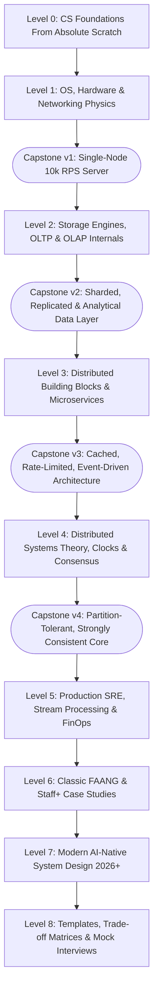

# Master System Design Roadmap: Zero to Staff+ & AI-Native Architect

> **Philosophy**: Every distributed system is constrained by physical reality—CPU cycles, RAM bandwidth, Disk I/O seeks, and the speed of light in fiber-optic cables. We start at the metal (OS & Networking) and build upward to planetary-scale and AI-native systems.
>
> **Hands-On Strategy (No Docker / AWS WorkSpaces Compatible)**: Every module pairs deep architectural theory + Mermaid diagrams with **pure-Python simulations** (`socket`, `asyncio`, `threading`, `sqlite3`, `hashlib`, etc.) so you build real muscle memory without needing containers.

---

## Architecture of This Curriculum (Dual-Track: Bottom-Up Physics + Evolving System)

> **Why Most Roadmaps Fail**: Pure bottom-up roadmaps cause "theory fatigue" because you wait months before designing a full system. Pure top-down roadmaps teach you to memorize boxes (`Client -> LB -> Service -> Redis -> DB`) without understanding *why* they break.
>
> **Our Revision (The "Spiral Capstone" Method)**: At the end of **every single level**, we apply what we just learned to evolve a real system from **100 users on 1 box $\rightarrow$ 100M global users**, plus a **Level Boss Fight (Mini Mock Interview)**.

---

## Level 0: Computer Science Foundations From Scratch (`00-CS-Foundations-From-Scratch/`)
*Zero jargon assumed. If terms like "memory address", "pointer", "hash table", "binary tree", "kernel", or "socket" feel foggy, start here first.*

- [ ] **0.1 How a Computer Actually Runs Code (Bits, Bytes, CPU, RAM & Disk)**: What physically happens when you write `x = 42`? Memory addresses (house numbers), CPU registers (your hands), RAM (your workbench), and SSD (the warehouse).
  - *Python Lab*: `0.1_memory_and_bytes.py` (Inspect raw bits, bytes, memory addresses with `id()`, and see contiguous arrays vs. scattered objects).
- [ ] **0.2 What an Operating System Actually Does (Kernel, Processes, Threads & Syscalls)**: Why your Python script isn't allowed to touch the SSD or network card directly; the Restaurant Kitchen analogy for Processes vs. Threads vs. Event Loops.
  - *Python Lab*: `0.2_processes_vs_threads.py` (Watch the OS create separate memory spaces for processes vs. shared memory for threads).
- [ ] **0.3 The 4 Data Structures That Run the World (Arrays, Linked Lists, Hash Tables & Trees)**: Big-O notation in plain English ($O(1), O(\log N), O(N)$); how a Hash Function turns `"user_123"` into an instant array slot; how a Tree cuts 1,000,000 items into 20 steps.
  - *Python Lab*: `0.3_data_structures_from_scratch.py` (Build a miniature Hash Table and Binary Search Tree from scratch and race them against a plain list scan).
- [ ] **0.4 How Two Programs Talk Over a Wire (IP Addresses, Ports, Packets & Sockets)**: The Postal System analogy—IP address (building address), Port number (apartment number), Packet (envelope with max size), and Socket (the mailbox door).
  - *Python Lab*: `0.4_first_socket_chat.py` (Send raw bytes between two functions using a real loopback socket).
- [ ] **0.5 The Math of System Performance (Latency vs. Throughput, Averages vs. Percentiles $p50/p95/p99$)**: Why "average latency" lies when 1 out of 20 customers waits 10 seconds; what Throughput (highway lanes) vs. Latency (speed limit) really means.
  - *Python Lab*: `0.5_percentiles_vs_averages.py` (Simulate a coffee shop queue and see why Average looks fine while $p99$ is a disaster).

---

## Level 1: OS, Hardware & Networking Physics (`01-OS-And-Networking-Foundations/`)
*Before designing for 100M users, you must understand what happens inside a single machine and across a single wire.*

- [ ] **1.0 CS Primer for Level 1 (From Scratch)**: CPU Clock Cycles, Cache Lines (why grabbing 1 item grabs its neighbors), Virtual Memory, the OS Page Cache (the OS's secret notepad), and Blocking vs. Non-Blocking I/O.
  - *Python Lab*: `1.0_cache_and_io_primer.py` (Visualize sequential vs. random memory access and blocking vs. non-blocking waits).
- [ ] **1.1 Hardware & Latency Numbers Every Architect Must Know**: CPU caches (L1/L2/L3), RAM vs. NVMe SSD vs. Network RTT, and Back-of-the-Envelope math.
  - *Python Lab*: `latency_benchmark.py` (Measure memory vs. OS Page Cache vs. disk `fsync` vs. localhost socket vs. hash compute in Python).
- [ ] **1.2 OS Internals for Backend Scale**: Processes vs. Threads vs. Coroutines (`asyncio`), Kernel vs. User Space, Context Switching, Virtual Memory, Page Cache, and `fsync`.
  - *Python Lab*: `c10k_concurrency_lab.py` (Compare Thread-per-connection vs. Non-blocking Event Loop / `selectors` under 1,000 concurrent connections).
- [ ] **1.3 Networking From the Wire Up**: OSI/TCP-IP Stack, TCP 3-Way Handshake, Congestion Control, Head-of-Line Blocking, UDP, and TLS 1.3 handshake overhead.
  - *Python Lab*: `raw_tcp_udp_server.py` (Build a raw TCP & UDP echo server with `socket` and inspect framing/partial reads).
- [ ] **1.4 Application Protocols**: HTTP/1.1 vs. HTTP/2 (multiplexing) vs. HTTP/3 (QUIC over UDP), WebSockets, Server-Sent Events (SSE), gRPC (Protobuf), and GraphQL.
  - *Python Lab*: `http_vs_sse_streaming.py` (Implement raw HTTP/1.1 keep-alive and SSE streaming server).
- [ ] **1.5 DNS, Anycast & Edge Routing**: How a packet finds your server—Recursive/Authoritative DNS, TTL trade-offs, BGP Anycast, and Geo-DNS.
- [ ] **1.6 Level 1 Boss Fight (Spiral Capstone v1)**: *Design & Benchmark a Single-Server High-Concurrency Ingestion API*—diagnose whether your bottleneck is CPU, RAM, Disk `fsync`, Ephemeral Ports, or Event Loop blocking.

---

## Level 2: Data & Storage Engine Internals (`02-Storage-Engines-And-Databases/`)
*Databases are not black boxes. At scale, choosing the wrong storage engine will destroy your write throughput or read latency.*

- [ ] **2.0 CS Primer for Level 2 (From Scratch)**: How files live on disk (blocks/pages), Binary Search Trees vs. B-Trees (why disk trees are fat and short), Append-Only Logs vs. In-Place Updates, and Locks/Mutexes.
  - *Python Lab*: `2.0_files_indexes_and_locks.py` (Build a simple file index from scratch and see why updating the middle of a file is slow).
- [ ] **2.1 How Databases Store Data on Disk**: Write-Ahead Log (WAL), Pages, B+ Trees (PostgreSQL/MySQL InnoDB) vs. LSM Trees + SSTables + Bloom Filters (RocksDB/Cassandra).
  - *Python Lab*: `mini_lsm_engine.py` (Build a working Log-Structured Merge-tree KV store with WAL, MemTable, and Bloom Filter in <150 lines of Python).
- [ ] **2.2 Relational Internals & ACID**: Isolation Levels (Read Committed, Repeatable Read, Serializable), MVCC (Multi-Version Concurrency Control), Write Skew, Phantom Reads, and Indexing (Composite, Covering, B-Tree).
  - *Python Lab*: `sqlite_mvcc_concurrency.py` (Simulate race conditions, double-booking, optimistic vs. pessimistic locking using Python `sqlite3` in WAL mode).
- [ ] **2.3 Replication Architecture**: Single-Leader (Sync vs. Async, Replication Lag anomalies: Read-Your-Writes, Monotonic Reads), Multi-Leader, Leaderless (Dynamo-style Quorums $R + W > N$, Sloppy Quorums, Hinted Handoff, Read Repair).
  - *Python Lab*: `quorum_replication_sim.py` (Simulate a 5-node leaderless cluster with tunable $N, R, W$ and read-repair).
- [ ] **2.4 Partitioning / Sharding Strategies**: Range-based vs. Hash-based sharding, Consistent Hashing with Virtual Nodes, Hot Key / Celebrity Problem, and Secondary Index partitioning (Document-Partitioned/Local vs. Term-Partitioned/Global).
  - *Python Lab*: `consistent_hashing_ring.py` (Implement a Consistent Hash Ring with virtual nodes and measure key migration % when a node dies).
- [ ] **2.5 OLTP (Row-Store) vs. OLAP (Columnar) & Polyglot Persistence**: Row-oriented (`SQLite`/`Postgres`) vs. Columnar Vectorized Engines (`DuckDB`/`ClickHouse`/Parquet), Wide-Column, Graph, Time-Series, and Inverted Index (Elasticsearch).
  - *Python Lab*: `oltp_vs_olap_benchmark.py` (Benchmark `sqlite3` vs. `duckdb` on 1,000,000 rows: point lookups vs. analytical aggregations).
- [ ] **2.6 Level 2 Boss Fight (Spiral Capstone v2)**: *Architect the Data Layer for a Multi-Tenant SaaS + Real-Time Analytics Dashboard*—choose sharding keys, handle hot tenants, and separate OLTP from OLAP without killing transactional latency.

---

## Level 3: Core Distributed Building Blocks (`03-Distributed-Building-Blocks/`)
*The Lego bricks of every large-scale architecture.*

- [ ] **3.0 CS Primer for Level 3 (From Scratch)**: Proxies (middlemen), Hash Modulo (`hash(key) % N`) and why it breaks when `N` changes, Queues (FIFO lines), and Pub/Sub (radio broadcast vs. direct phone call).
  - *Python Lab*: `3.0_modulo_vs_queues_primer.py` (See why `hash(key) % N` remaps 80%+ of keys when 1 server is added).
- [ ] **3.1 Load Balancing at Scale**: L4 (Transport/TCP) vs. L7 (Application/HTTP) Load Balancers, Algorithms (Round Robin, Least Connections, Power of Two Choices, Consistent Hash), Maglev, DSR (Direct Server Return).
  - *Python Lab*: `l7_reverse_proxy.py` (Build an async L7 load balancer with health checks and Power-of-Two-Choices routing).
- [ ] **3.2 Caching Architecture & Failure Modes**: Cache-Aside, Read-Through, Write-Through, Write-Behind; Eviction (LRU, LFU, Window-TinyLFU); Cache Stampede (Thundering Herd), Penetration (Bloom Filter), Avalanche, and Hot Key mitigation.
  - *Python Lab*: `lru_stampede_protection.py` (Build a `fakeredis`-backed cache with Singleflight / Promise coalescing and probabilistic early expiration).
- [ ] **3.3 Rate Limiting & Traffic Shaping**: Token Bucket, Leaky Bucket, Fixed Window, Sliding Window Log, Sliding Window Counter, and Distributed Rate Limiting (Redis Lua atomicity / Race conditions).
  - *Python Lab*: `rate_limiters.py` (Implement & benchmark Token Bucket and Sliding Window rate limiters under burst traffic).
- [ ] **3.4 Asynchronous Messaging & Event Streaming**: Point-to-Point Queues (RabbitMQ/SQS) vs. Append-Only Commit Logs (Kafka), Consumer Groups, Partition Ordering, Backpressure, Dead Letter Queues (DLQ).
  - *Python Lab*: `mini_kafka_broker.py` (Build a partitioned, disk-backed append-only log broker with consumer offset tracking).
- [ ] **3.5 Distributed Unique ID Generators**: UUIDv4 vs. UUIDv7 (time-ordered B-Tree friendly) vs. Database Ticket Servers vs. Twitter Snowflake (64-bit layout) vs. Clock Skew hazards.
  - *Python Lab*: `snowflake_id_generator.py` (Build a lock-free Snowflake ID generator producing 100k+ sortable IDs/sec and compare B-Tree insert speed of UUIDv4 vs. Snowflake).
- [ ] **3.6 Service Decomposition, API Gateways & Schema Evolution**: Modular Monolith vs. Microservices, BFF (Backend-for-Frontend), Service Discovery, Sidecar/Service Mesh (Envoy), and Backward/Forward Schema Compatibility.
- [ ] **3.7 Level 3 Boss Fight (Spiral Capstone v3)**: *Scale a Flash-Sale E-Commerce Architecture from 1K to 500K Peak RPS* using Edge Caching, Singleflight, Token Bucket Queueing, and Async Order Processing.

---

## Level 4: Distributed Systems Theory & Consensus (`04-Distributed-Systems-Internals/`)
*Where Senior Engineers become Staff+ Architects—understanding what breaks when networks partition and clocks lie.*

- [ ] **4.0 CS Primer for Level 4 (From Scratch)**: State Machines (deterministic inputs $\rightarrow$ outputs), why two computers never have the exact same clock time, Quorums (majority voting), and Idempotency ($f(f(x)) = f(x)$).
  - *Python Lab*: `4.0_state_machines_and_idempotency.py` (See how duplicate network retries corrupt a bank balance and how an Idempotency Key fixes it in 10 lines of code).
- [ ] **4.1 The Eight Fallacies of Distributed Computing & Partial Failures**: Network partitions, asymmetric links, grey failures, GC pauses, and why timeouts are never simple.
- [ ] **4.2 Time, Clocks & Ordering**: Physical Clocks (NTP skew), Monotonic vs. Wall-Clock Time, Lamport Timestamps, Vector Clocks, and Google TrueTime (Spanner).
  - *Python Lab*: `vector_clocks_causality.py` (Detect causal ordering vs. concurrent conflicts across 3 nodes using Vector Clocks).
- [ ] **4.3 CAP Theorem, PACELC & Consistency Models**: Linearizability vs. Sequential Consistency vs. Causal Consistency vs. Eventual Consistency; CRDTs (Conflict-Free Replicated Data Types).
- [ ] **4.4 Consensus, Leader Election & Distributed Locks**: Split-Brain problem, **Fencing Tokens** (why Redlock alone is unsafe for correctness), Paxos intuition, and **Raft** (Leader Election, Log Replication, Safety).
  - *Python Lab*: `raft_leader_election.py` (Simulate a 5-node Raft cluster with heartbeats, randomized election timeouts, and split-brain prevention via fencing tokens).
- [ ] **4.5 Distributed Transactions**: Two-Phase Commit (2PC) & why it blocks, Saga Pattern (Choreography vs. Orchestration), Transactional Outbox Pattern, Change Data Capture (CDC), and Idempotency Keys.
  - *Python Lab*: `saga_orchestrator_outbox.py` (Simulate an e-commerce order/payment/inventory workflow with Transactional Outbox, compensating transactions, and idempotency keys).
- [ ] **4.6 Level 4 Boss Fight (Spiral Capstone v4)**: *Survive a Split-Brain Network Partition in a Distributed Ledger & Inventory System* without double-charging or corrupting state.

---

## Level 5: Production Architecture, Stream Processing, SRE & FinOps (`05-Production-And-SRE/`)
*What separates textbook diagrams from systems that survive Black Friday and don't bankrupt the company.*

- [ ] **5.0 CS Primer for Level 5 (From Scratch)**: Probability of Failure (why 99.9% uptime across 50 microservices equals 95% uptime), Exponential growth (retry storms), and Cryptography basics (Symmetric AES vs. Asymmetric Public/Private Keys vs. Hashing).
  - *Python Lab*: `5.0_crypto_and_reliability_math.py` (Benchmark hashing vs. AES encryption vs. RSA signing and simulate compound microservice failure probabilities).
- [ ] **5.1 Resiliency & Metastable Failures**: Circuit Breakers, Exponential Backoff with Full Jitter, Bulkheads, Adaptive Load Shedding, Graceful Degradation, and Retry Storms.
  - *Python Lab*: `circuit_breaker_jitter.py` (Simulate a cascading retry storm and fix it with an adaptive Circuit Breaker + Full Jitter).
- [ ] **5.2 Real-Time Stream Processing Architecture**: Flink/Kafka Streams internals—Event Time vs. Processing Time, Watermarks (handling late-arriving data), Tumbling/Sliding/Session Windows, and Exactly-Once Processing.
  - *Python Lab*: `stream_window_watermarks.py` (Build an event-time tumbling window aggregator with watermarks and late-event side outputs).
- [ ] **5.3 Observability at Scale**: The Three Pillars (Metrics, Structured Logs, Distributed Tracing via OpenTelemetry), RED/USE methods, Tail Latency ($p95, p99, p99.9$), HDR Histograms, and Coordinated Omission.
- [ ] **5.4 Multi-Region High Availability, Zero-Downtime Migrations & Cell Architecture**: Active-Passive vs. Active-Active multi-region, RPO vs. RTO, **Cell-Based Architecture & Shuffle Sharding** (combinatorial blast-radius isolation), and Dual-Write Zero-Downtime DB Migrations.
  - *Python Lab*: `shuffle_sharding_simulator.py` (Prove mathematically and empirically how Shuffle Sharding reduces noisy-neighbor blast radius from 25% of customers down to <0.5%).
- [ ] **5.5 Cloud FinOps & Security Architecture**: Why NAT Gateways, cross-AZ data transfer, and S3 request costs silently kill startups; Tiered Storage; API Gateway Auth (JWT vs. Opaque Tokens), mTLS, DDoS mitigation, and Envelope Encryption (KMS).

---

## Level 6: Classic FAANG & Staff+ Case Studies (`06-Classic-Case-Studies/`)
*Applying Levels 1–5 to end-to-end systems using the 45-minute Staff+ interview framework.*

- [ ] **6.1 Read-Heavy & Edge Systems**: URL Shortener (TinyURL) & Pastebin; Global Content Delivery Network (CDN).
- [ ] **6.2 Social & Fan-Out Systems**: Twitter/X News Feed (Push vs. Pull vs. Hybrid fan-out for celebrities).
- [ ] **6.3 Real-Time & Stateful Systems**: WhatsApp / Slack (1:1 & Group Chat, Presence, End-to-End Encryption); Live Comment Streaming (Twitch/YouTube Live at 5M concurrent viewers).
- [ ] **6.4 High-Contention & Transactional Systems**: Ticketmaster (Flash Sales / High-contention seat locking without DB meltdown); Distributed Payment System & Double-Entry Ledger (Stripe).
- [ ] **6.5 Geospatial & Matching Systems**: Uber / Lyft (QuadTrees vs. Google S2 vs. Uber H3 hexagonal spatial index, real-time driver location ingestion).
- [ ] **6.6 Massive Storage & Media Systems**: YouTube / Netflix (Chunked resumable uploads, DAG transcoding pipeline, Adaptive Bitrate HLS/DASH); Dropbox / Google Drive (Block-level delta sync, content-addressable storage).
- [ ] **6.7 Infrastructure & Search Systems**: Distributed Web Crawler; Typeahead / Autocomplete (Trie + Top-K); Distributed Task Scheduler; Notification System; Metrics Monitoring System (Prometheus/Datadog).

---

## Level 7: Modern AI-Native System Design (2026+) (`07-AI-Native-System-Design/`)
*The new frontier of Staff+ System Design interviews and production engineering.*

- [ ] **7.0 CS & Math Primer for AI Systems (From Scratch)**: What is a Token, what is a Vector/Embedding (turning meaning into a list of numbers / GPS coordinates in meaning-space), Dot Product / Cosine Similarity, and Matrix Multiplication on GPUs vs. CPUs.
  - *Python Lab*: `7.0_vectors_and_embeddings_from_scratch.py` (Plot word vectors in 3D/ND using `numpy` and find similar meanings with 5 lines of math).

- [ ] **7.1 LLM Inference Serving at Scale**: Prefill (compute-bound) vs. Decode (memory-bandwidth bound), KV-Cache architecture, PagedAttention (vLLM), Continuous Batching, Speculative Decoding, and Prefix Caching.
- [ ] **7.2 Vector Databases & Approximate Nearest Neighbor (ANN) Internals**: Flat Index vs. IVF (Inverted File) vs. **HNSW (Hierarchical Navigable Small World)** graphs, Product Quantization (PQ), and Hybrid Search (BM25 + Dense Embeddings + Reciprocal Rank Fusion).
  - *Python Lab*: `hybrid_search_rrf.py` (Implement BM25 keyword search + Cosine vector similarity + Reciprocal Rank Fusion from scratch).
- [ ] **7.3 Production RAG & Knowledge Ingestion Pipelines**: Semantic chunking, embedding drift, Document ACLs (Security trimming in vector search), Reranking pipelines, and Semantic Caching.
- [ ] **7.4 Multi-Agent Orchestration & Durable Execution**: Designing fault-tolerant agentic workflows (Temporal-style durable execution), Tool-Call sandboxing, human-in-the-loop state machines, and context window compaction.
- [ ] **7.5 AI Gateway, Guardrails & Token FinOps**: Token-based rate limiting (TPM/RPM), Semantic Router (routing easy queries to small models, hard to frontier models), PII scrubbing, Prompt Injection firewalls, and LLM Evaluation/Observability pipelines.

---

## Level 8: Templates, Trade-off Matrices & Mock Interviews (`08-Templates-And-Checklists/`)
- `45-min-interview-framework.md`: Your repeatable step-by-step blueprint for any design question.
- `latency-and-capacity-cheatsheet.md`: Powers of 2, latency numbers, QPS-to-storage formulas.
- `technology-tradeoff-matrix.md`: When to choose X over Y (Kafka vs. RabbitMQ, Postgres vs. Cassandra, Redis vs. Memcached).
- `mock-interview-log.md`: Scorecard and feedback from our simulated mock interviews.
